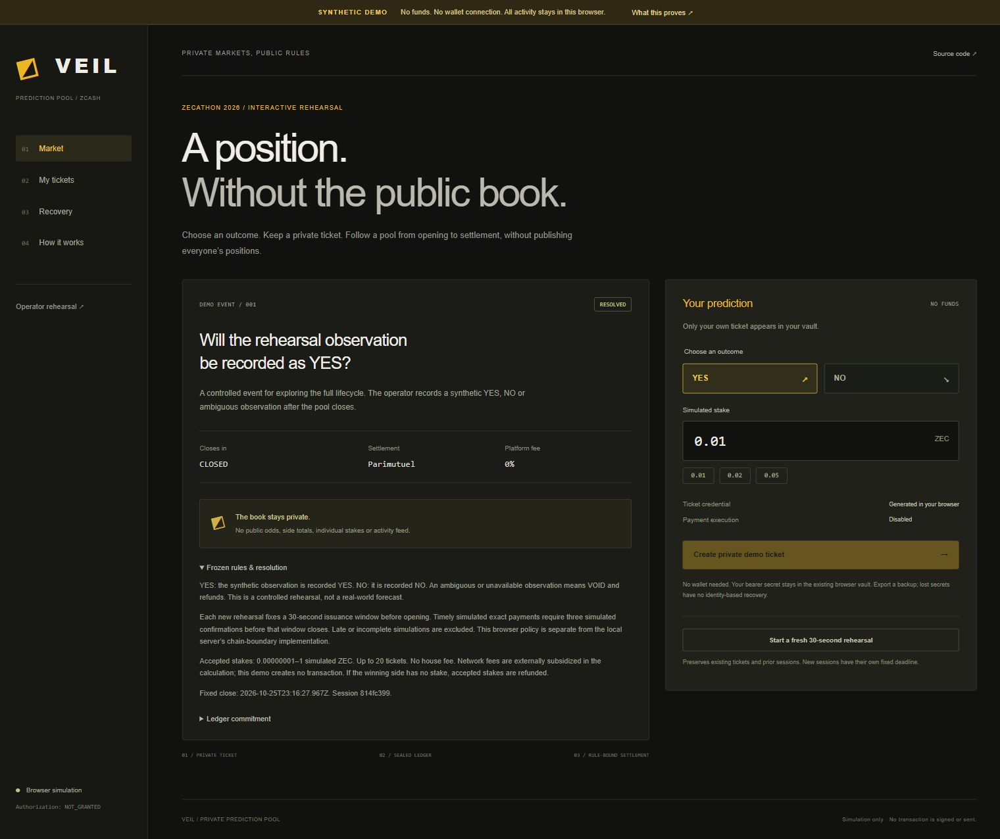

# VEIL

An accountless binary prediction pool built around Zcash shielded payments and
private bearer tickets. The public interface shows rules and market status,
without publishing individual positions, stakes, odds or side totals.

**Current release: synthetic demonstration. No funds move.** Integrated genuine
testnet deposits and payouts remain unverified. Financial authorization is
`NOT_GRANTED`; production trust is `UNAVAILABLE`. FROST is deferred.

## Try the browser rehearsal

**[Open the public browser rehearsal](https://veil-zecathon-2026.jimohsamad2005.chatgpt.site)** · [Two-minute captioned walkthrough](https://veil-zecathon-2026.jimohsamad2005.chatgpt.site/demo-video.html)



The browser rehearsal requires no wallet or command line. Create a private demo
ticket, simulate its exact deposit and three confirmations before the fixed
30-second close, then open **Operator rehearsal** to seal and resolve. Return to
**My tickets** to review an eligible claim and prepare an **unsent** intent.
Choose VOID for refunds, or NO after funding only YES tickets for no-winner refunds.

This isolated simulation reuses the application’s browser vault, backup format,
claim commitment, blinded ledger commitment and integer-zatoshi settlement code.
It has no wallet or database connection and emits no payable Zcash requests.
Simulated confirmations, oracle evidence and reservations do not prove server
concurrency, external publication or genuine blockchain payment execution.

## What is implemented

- Client-generated 256-bit bearer secrets and ticket-bound claim commitments.
- Browser-local multi-ticket vault, individual export and validated recovery.
- Native allocator and exact ZIP-321 integration in the local application.
- Canonical watcher reconciliation and authenticated private payment status.
- Atomic SQL lock and retained-blinding ledger commitment in the TEST lifecycle.
- Rule-bound YES/NO/VOID resolution, exact parimutuel settlement and refunds.
- Credential-verified claims, replay-safe SQL reservations and unsent payout intents.

The web/API holds no spending authority. A prepared intent is not a paid claim.
The browser rehearsal and the deeper PostgreSQL-backed TEST demo are distinct.

## Build the browser rehearsal

Use Node.js 24 (`>=24.21.0 <25`) and the committed npm lockfile:

```powershell
npm.cmd ci --ignore-scripts
npm.cmd run build:judge
node --test apps/judge-demo/engine.test.mjs
```

Serve `apps/judge-demo/dist` through a static HTTP server or HTTPS hosting.
Opening `index.html` directly as a file is unsupported: secure browser storage
and module loading are required. No environment file or database is needed.

## Local PostgreSQL-backed TEST demo

The deeper lifecycle is currently supported on Windows with PostgreSQL 18.6,
Rust 1.99.0/MSVC and a preconfigured identity-checked disposable TEST profile.
It uses synthetic receivers, chain observations and publication evidence; signing
and broadcast remain disabled. It is intended for local developer verification.

```powershell
powershell.exe -NoProfile -ExecutionPolicy Bypass -File scripts/dev/submission-demo.ps1 -Action Demo
```

Open `http://127.0.0.1:3002/demo` for the separate operator rehearsal and `/` for
participation. Never fund its valid-format synthetic payment requests. The market’s
fixed ten-minute deadline and session cleanup are enforced by the existing launcher.

Wallet-free validation on the configured TEST installation:

```powershell
powershell.exe -NoProfile -ExecutionPolicy Bypass -File scripts/dev/submission-demo.ps1 -Action Test
powershell.exe -NoProfile -ExecutionPolicy Bypass -File scripts/dev/submission-demo.ps1 -Action Regression
```

Do not run broad recursive test discovery: some suites initialize wallet fixtures.
The inert `.env.example` contains no authority and is not required for the browser demo.

## Privacy and trust

Positions, stake sizes and payouts are intended to be hidden from the public
blockchain and other market participants through shielded payments. The market
operator has the viewing/application access required for settlement. **Synthetic
demonstrations do not prove blockchain privacy or real payment execution.**

The operator sees the private book and supplies a manual oracle. A ledger root
binds a snapshot; it does not prove completeness, honesty, solvency or oracle truth.
Browser storage and ticket backups are unencrypted. Bearer-secret loss has no
identity recovery. Website/IP/browser/timing metadata remains observable.
No audited-production, trustless, operator-blind or active threshold-signing claim.

Protocol domain strings, storage names and backup identifiers retain their original
`DARKPOOL` values for compatibility. VEIL is the chosen presentation brand; other
crypto projects use the name. No uniqueness or affiliation is claimed.

## Verification

On 26 October 2026 (Africa/Lagos), the updated local wallet-free lifecycle suite
passed **46/46**, focused protocol regressions passed **113/113**, browser-demo
checks passed **5/5**, and genuine-deposit boundary units passed **7/7**. These
are synthetic/unit results; they do not establish genuine integrated payments.

## Source and license

Created by Jimoh Abdulsamad. Original code: [MIT](LICENSE).
See [architecture](docs/ARCHITECTURE.md), [specification](docs/SPEC.md),
[threat model](docs/THREAT_MODEL.md) and [third-party notices](docs/THIRD_PARTY_NOTICES.md).

This repository is the source release. A public demo or video is not a ZECATHON
submission receipt. Submission is complete only after the event platform confirms it.
