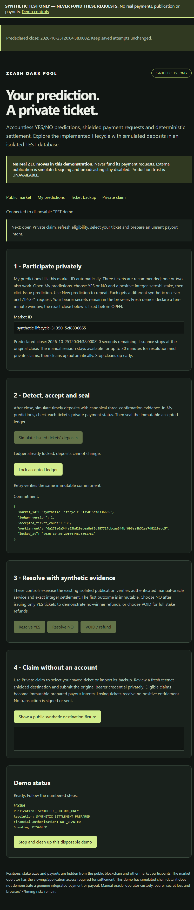
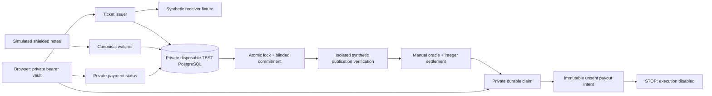

# Zcash Dark Pool

An accountless YES/NO parimutuel prediction pool built around Zcash shielded
payments and private bearer tickets. Public observers see no live side/stake
order book. The operator retains the visibility needed to settle the market.

**ZECATHON submission: working synthetic end-to-end product demo.** Integrated
genuine testnet deposits and payouts are **UNVERIFIED**. The demonstration uses
synthetic receivers, chain observations and publication evidence. No ZEC is sent;
signing and broadcast are disabled. Production trust is **UNAVAILABLE** and
financial authorization is **NOT_GRANTED**.

## Demonstrated functionality

- Browser YES/NO ticket issuance and exact ZIP-321 payment requests.
- Client-generated bearer credentials, local multi-ticket vault and backup/import.
- Private payment status backed by the watcher acceptance path in a TEST fixture.
- Atomic accepted-ledger lock and versioned, blinded Merkle commitment.
- Authenticated manual YES/NO/VOID resolution and integer-zatoshi settlement.
- Zero rake, externally subsidized fees, deterministic rounding and full refunds
  under the frozen no-winner/VOID policies.
- Private claims, original-secret verification and replay-safe SQL reservations.
- Immutable **unsent** payout intents. RESERVED/PREPARED does not mean paid.

The wallet-free UI/lifecycle suite passed **46/46** and focused protocol
regressions passed **113/113** on 25 October 2026. Retained TAP digests and tested
source hashes were rechecked during submission preparation. These are synthetic
tests, not evidence of genuine integrated deposits or payouts.



## Setup

The full demonstration is currently supported on **Windows**, using a normal
operator account, PowerShell 5.1, PostgreSQL **18.6**, and Chrome or Edge. It is a
local application, not a hosted service. Install Node.js **24.21.0** (the pinned
version; package engines permit `>=24.21.0 <25`), Rust **1.99.0**, and the Windows
MSVC C++ build tools. Ensure `node`, `npm.cmd`, `cargo`, `postgres`, `initdb`,
`pg_ctl` and `psql` resolve to trusted installations in your shell.

From the project root, install dependencies and populate the Rust cache:

```powershell
npm.cmd ci --ignore-scripts
if ($LASTEXITCODE -ne 0) { throw 'npm install failed' }
cargo fetch --locked
if ($LASTEXITCODE -ne 0) { throw 'Rust dependency fetch failed' }
```

The launch wrapper subsequently builds the required Rust examples **offline**.
No binaries, dependency caches, database credentials or wallet files are bundled.
The root `.env.example` is inert; do not populate it with wallet keys or database
passwords. A fresh-machine installation has not been rehearsed as a public
distribution; recorded verification uses the configured development machine.

The demo requires the existing identity-checked **TEST/55433** profile and
CurrentUser-protected maintenance credential. On a **new machine only**, review
the create-only target plan first:

```powershell
powershell.exe -NoProfile -ExecutionPolicy Bypass -File scripts/dev/postgres-isolated.ps1 -Kind TEST -Plan
```

After explicit local approval, the existing `-Kind TEST -Create` action initializes
a fresh TEST cluster and protected credential. It refuses an existing root or
occupied port; it is not a repair/reset command. This action changes local state
and is **not** part of the recording or submission-preparation audit. Never run it
over an existing TEST installation. Do not run the retired `postgres.ps1`.

## Run the synthetic product

With the configured TEST cluster already running:

```powershell
powershell.exe -NoProfile -ExecutionPolicy Bypass -File scripts/dev/submission-demo.ps1 -Action Demo
```

Open **http://127.0.0.1:3002/demo** in a separate private browser window:

1. Choose YES/NO and stake, then **Issue prediction**. Use **New prediction** for
   each additional ticket; three tickets are recommended, one to three supported.
2. Issue before the displayed immutable close. After close, simulate deposits,
   check private **CONFIRMED** status, and lock the accepted ledger.
3. Resolve YES/NO/VOID, select an eligible saved ticket on `/claim`, review the
   synthetic destination and reserve/prepare the claim privately.
4. Show **Payment has NOT been sent or confirmed**, then **Stop and clean up**.
   Wait for `SYNTHETIC_DEMO_CLEANUP_CONFIRMED` in the terminal.

**Never fund these valid-format synthetic requests.** New manual sessions last
30 minutes; issuance closes ten minutes after its predeclared setup boundary.
The session timeout never extends or reopens a market. Preserve old saved drafts
and incomplete attempts; issue new drafts for each new fixture. Within the same
market, use the saved retry action rather than creating duplicate attempts.

See the [four-minute recording guide](docs/SUBMISSION_DEMO.md). Waiting for the
unchanged market deadline may be edited out with a visible elapsed-time caption.

## Validate

```powershell
powershell.exe -NoProfile -ExecutionPolicy Bypass -File scripts/dev/submission-demo.ps1 -Action Test
powershell.exe -NoProfile -ExecutionPolicy Bypass -File scripts/dev/submission-demo.ps1 -Action Regression
```

These wrappers use literal wallet-free test lists. `Test` uses new disposable,
identity-bound databases and roles within TEST/55433; `Regression` runs focused
calculation/verification suites. No wallet is initialized. Do not substitute a
recursive test-discovery command or the Phase 7 wallet-fixture suite.

## Architecture



Native Zcash receiver allocation, viewing/scanning and historical wallet/PCZT
experiments are separate components. They do not replace genuine transaction
verification for this product. Activating a receiver, funding it or executing a
payout requires separate approval and unresolved integration work.

## Privacy, trust and limitations

Positions, stake sizes and payouts are intended to be hidden from the public
blockchain and other market participants using shielded payments. The market
operator has viewing/application access required for settlement. **The synthetic
demo does not prove blockchain privacy or payment execution.**

Bearer-secret loss has no identity-based recovery. Local browser storage and
ticket backups are sensitive and are not encrypted by the app. IP/browser/timing
metadata, operator visibility and manual-oracle trust remain. A ledger root binds
a snapshot; it does not prove deposit completeness, operator honesty or solvency.
FROST is deferred. No production-ready, operator-blind or trustless claim is made.

Windows account/ACL activation, genuine receiver activation, optional witness/TSA
and recovery work are frozen for submission. DEV/55435 is status-only; OLD LIVE,
HISTORICAL and protected wallet material must never be used by this demo.

## License and developer

Created by **Jimoh Abdulsamad**, individual developer. Public project name:
**Zcash Dark Pool**; intended source repository name: **`zcash-dark-pool`**.

Original project code is licensed under the [MIT License](LICENSE), copyright
2026 Jimoh Abdulsamad. Third-party dependencies and included public test fixtures
retain their respective licenses and notices. No additional team members or
contributors are asserted by this credit.
See the [third-party source notices](docs/THIRD_PARTY_NOTICES.md).

## Submission package

- [Product requirements](docs/PRD.md), [frozen specification](docs/SPEC.md),
  [architecture](docs/ARCHITECTURE.md), [threat model](docs/THREAT_MODEL.md),
  [implementation plan](docs/IMPLEMENTATION_PLAN.md), [test plan](docs/TEST_PLAN.md).
- [Recording guide](docs/SUBMISSION_DEMO.md) and
  [release audit, materials and next actions](docs/SUBMISSION_READINESS.md).
- [Exact public-source inventory](submission/PUBLIC_RELEASE_MANIFEST.json).

The inventory describes a curated source snapshot, **not permission to publish
this working directory or its Git history**. Local evidence, credentials, wallet
databases, browser backups and historical operational notes are excluded and
preserved locally. The MIT license and individual developer credit are approved;
the source destination account/URL, publication and final video remain pending.
A new local root commit may be prepared only in the separately approved clean
export. No remote, upload or deployment is authorized; private history is preserved.
