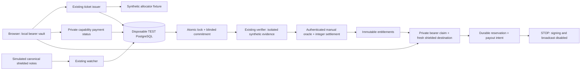

# Zcash Dark Pool — submission demonstration

Submission target: **28 October 2026**. Current deliverable: a working **synthetic
end-to-end product demonstration**, plus separately documented historical Zcash
wallet/PCZT spike evidence. The integrated product has not made a genuine
testnet deposit or payout. Do not describe this as a complete live financial MVP.

## Run the product now

Use the existing normal Windows TEST operator account, not Administrator or a
service account. The already configured TEST cluster on 55433 must be running
with its matching physical profile and protected maintenance credential. This
command does not start, reset or repair any cluster. Do not use DEV/55435,
OLD LIVE/55434, HISTORICAL/55432 or the unprovisioned observation target.

From `zcash-dark-pool`:

```powershell
powershell.exe -NoProfile -ExecutionPolicy Bypass -File scripts/dev/submission-demo.ps1 -Action Demo
```

Open **http://127.0.0.1:3002/demo**. Keep existing browser data intact; an optional
separate InPrivate/Incognito window provides a clean recording without resetting
the existing vault. The
launcher prints the URL only after the synthetic market is OPEN. It compiles
only existing stateless address/ZIP-321 decoders and builds the existing browser
assets. It creates a new OID-bound disposable TEST database, applies existing
0001–0013 migrations there, and uses the existing purpose-specific roles. No
schema migration, OS account, wallet or persistent environment is created.

Use **Stop and clean up** when finished. Check terminal PASS and
`SYNTHETIC_DEMO_CLEANUP_CONFIRMED`; that statement follows successful identity-
checked database/role teardown. New manual sessions automatically end after
**30 minutes from the printed demo URL**, independently of the unchanged
ten-minute predeclared issuance close. This leaves approximately 20 minutes
after close for lock, resolution and private claims. The session cannot reopen
issuance or extend any market deadline.
Ctrl+C/SIGTERM is handled where Windows delivers it; force-killing PowerShell,
Node or the machine cannot guarantee cleanup. If completion is not confirmed,
preserve the receipt and inspect only the recorded disposable identities. Never
delete/reset a protected target to recover the demo. Closing the private window
discards only that window's synthetic browser storage; the server never clears
an existing participant vault.

Routes on the same origin:

| Route                      | Behavior                                                           |
| -------------------------- | ------------------------------------------------------------------ |
| `/demo`                    | Explicit synthetic operator controls and safe lifecycle projection |
| `/market`                  | Existing public market page; no private book                       |
| `/`                        | Existing browser vault, YES/NO issuance and ZIP-321 requests       |
| `/backup`                  | Existing individual bearer-ticket backup/import                    |
| `/claim`                   | Existing private ticket selection, destination review and claim    |
| `POST /api/payment-status` | Existing original-browser capability status                        |
| `POST /api/claim`          | Existing bearer verification and durable TEST reservation          |

All HTML pages carry a synthetic-only banner. Never fund these valid-format
synthetic address fixtures. The local synthetic authority is the existing TEST
fixture; it never calls GitHub, a real witness or FreeTSA. Production trust stays
UNAVAILABLE. Real publication remains PENDING/unavailable outside this fixture.

## Recording script

### Four-minute final edit

Prepare the installed tooling and running TEST cluster before recording. Launch
a fresh demo and issue before its original close. Record the real waiting
interval separately; trim it with a visible caption saying **"Waiting for the
unchanged predeclared close; no deadline was extended."** The final video is
four minutes, not a claim that the ten-minute market closed in four minutes.

| Final video time | Screen and narration                                                                                                                                             |
| ---------------- | ---------------------------------------------------------------------------------------------------------------------------------------------------------------- |
| 0:00–0:25        | Show the SYNTHETIC TEST banner and public market. State that no ZEC moves and the operator can see the private book.                                             |
| 0:25–1:15        | Issue YES 1000, NO 1000, YES 1000 using New prediction. Show saved tickets and payment requests; never open a bearer backup or secret.                           |
| 1:15–2:00        | After the labelled waiting cut, simulate deposits, show private CONFIRMED, then lock. Show accepted count and root.                                              |
| 2:00–2:30        | Resolve YES through the operator control; explain immutable integer entitlements, zero rake and external fee subsidy.                                            |
| 2:30–3:30        | Select a winning ticket on /claim, refresh eligibility, review the synthetic destination and submit. Show PREPARED and "Payment has NOT been sent or confirmed." |
| 3:30–4:00        | State genuine deposit/payout integration is unverified and spending disabled. Stop and show confirmed disposable cleanup.                                        |

Keep browser developer tools, request payloads, local-storage inspectors, private
files and password prompts out of the recording. A visible valid-format address
must retain the warning **never fund synthetic requests**. Capture real UI; do
not replace missing lifecycle steps with slides or simulated payment claims.

### Operator details

1. **Introduce the limitation, 20 seconds.** “This is the implemented product
   running against synthetic chain and publication evidence in a disposable
   PostgreSQL TEST database. No real ZEC moves.” Show the banner and `/market`.
2. **Participate, within the predeclared ten-minute close.** My predictions
   automatically fills the current market ID and shows its exact deadline.
   Create/issue three tickets, for example YES
   1000 zat, NO 1000 zat, YES 1000 zat. Choose a side and stake and click
   **Issue prediction**; use **New prediction** for each additional ticket.
   The current market tickets appear separately from older saved tickets and
   unassigned drafts. Saved retries retain their original choices and credentials.
   Three tickets are
   recommended; one or two completed tickets also support the remaining demo.
   Show distinct receiving requests, private local
   management and backup. Do not display/export bearer secrets in the recording.
3. **Acceptance and lock.** After the countdown reaches zero (trim the waiting
   portion of the recording if desired), click “Simulate
   issued tickets' deposits.” These synthetic notes have timely chain inclusion
   and are reconciled after close using the unchanged watcher. In My predictions,
   check private payment status: **CONFIRMED** appears on the ticket and any
   active payment panel, which stops prompting for another payment.
   Back at `/demo`, follow the prerequisite/next-action messages, lock and show the five-field
   commitment. Retrying lock preserves its root and blindings.
4. **Resolve.** Choose YES. The existing verifier checks isolated synthetic
   publication evidence; authenticated oracle resolution persists immutable
   integer entitlements. A later conflicting NO is rejected. Production trust
   has not changed. The pool pays full entitlements with zero rake and external
   fee subsidy; residuals follow the frozen largest-remainder rule.
5. **Private claim.** On `/demo`, show the explicitly public synthetic destination
   fixture; copy it into `/claim`. Select a saved winning ticket, review and
   confirm. If the claim page was already open before resolution, click
   **Refresh claim eligibility**; review also refreshes the public lifecycle state.
   Market readiness does not assert individual eligibility. Its secret travels
   only in a private POST. Show “Claim prepared” and
   “Payment has NOT been sent or confirmed.” Existing SQL uniqueness/locking and
   root/outcome binding protect retries; an intent is prepared, not signed.
   RESERVED means retained for preparation; PREPARED means an unsent payout
   instruction. Neither state means paid. A conflicting/failed request keeps a
   generic error; retry with the same ticket and destination.
6. **Close honestly.** Explain the genuine payment/executor blockers below. Show
   the separately labelled historical wallet spike if useful. Click Stop and
   show cleanup PASS. Do not relabel historical transfers as this demo's payout.

For a second run, use a fresh private window and a newly created fixture. Choose
NO for a NO-winner scenario. Issue only YES then resolve NO for no-winner refunds;
choose VOID for full accepted-stake refunds. Do not reset or mutate an existing
outcome. The automated four-scenario harness tests all these settlement modes.

## Architecture and privacy boundary



The operator can see the private book required for settlement. The public cannot
query individual sides, stakes, credentials, receiver mappings or destinations.
Browser storage/backups remain sensitive and are not encrypted by the app.
Accountless participation is not network anonymity or operator blindness.

## Exact missing genuine-payment integration

These boundaries remain, without starting another infrastructure phase:

| Missing link                  | Minimum code/decision                                                                                                                                                                                                                                                              |
| ----------------------------- | ---------------------------------------------------------------------------------------------------------------------------------------------------------------------------------------------------------------------------------------------------------------------------------- |
| Genuine issued-ticket deposit | Approved isolated financial target and view-only wallet context; purpose-bound allocator/scanner/issuer launch configuration using existing Rust implementations. Current observation adapters do not authorize acceptance. Do not promote status-only DEV.                        |
| Operational lifecycle         | Separate approved-target session adapters around `services/lock/db-session.mjs`, `services/operations/commands.mjs`, `services/claims/participant.mjs`; retain existing TEST fences and roles.                                                                                     |
| Real resolution authorization | Genuine policy-compliant commitment publication receipt and approved trust. Forward runtime clock/audit evidence in the operations publication adapter. Existing synthetic evidence cannot substitute.                                                                             |
| Payout-capable market         | Approved additive pre-OPEN payout/finality policy; 0007 defers payouts and 0013 keeps spending disabled. Never alter an already OPEN market's economics.                                                                                                                           |
| Genuine payout execution      | Implement `services/payout-authorization/interfaces.d.mts` against the existing PCZT path: verified funds/external fees, exact output/change review, durable signed bytes/transaction identity before broadcast, uncertainty quarantine and canonical confirmation/reorg evidence. |

Do not attempt to finish these by changing a trust flag, reusing protected wallets
or deleting lifecycle checks. No real spending is authorized by the demo command.

## Deadline sequence and deferrals

1. Run the automated product test and interactive demo on the existing TEST
   setup; keep its recording and actual screenshots ready.
2. Run the frozen-protocol regressions and four settlement scenarios.
3. Finish submission text/video with the exact simulated-versus-real distinction.
4. Windows account/ACL setup and genuine receiver activation are frozen for the
   submission. Submit the working synthetic lifecycle with clearly separated
   historical evidence; do not run the pending account/provisioning procedures.

Deferred: Windows SCM/service-account/DPAPI work, Computer B recovery, optional
witness/TSA work, production deployment, FROST, batching and other optional
features. Existing protections and the closed TSA milestone are preserved.

## Tests and evidence

```powershell
powershell.exe -NoProfile -ExecutionPolicy Bypass -File scripts/dev/submission-demo.ps1 -Action Test
powershell.exe -NoProfile -ExecutionPolicy Bypass -File scripts/dev/submission-demo.ps1 -Action Regression
powershell.exe -NoProfile -ExecutionPolicy Bypass -File scripts/dev/lifecycle-tests.ps1 -Action integration
```

The first two commands retain literal test lists, source/TAP hashes and receipts
under `.tools/submission-demo-tests/<id>`. No wallet-initializing suite or recursive
test discovery is invoked. The browser smoke test captures the actual synthetic
demo page to `.tools/submission-demo-screenshots/synthetic-lifecycle.png`; it is
not an image mock-up or genuine payment evidence.

The only shared fixture extension is an optional bounded 20–600 second pre-OPEN
close delay (600 seconds for new interactive demos, 45 seconds for the extended
reply-loss browser test, unchanged 20-second default for existing tests).
Frozen financial, commitment, credential and watcher algorithms,
migrations, protected environments and authorization guards remain unchanged.

### Executed results — 25 October 2026

| Run                                                                                                           | Result                       | Retained evidence                                                                                                                    |
| ------------------------------------------------------------------------------------------------------------- | ---------------------------- | ------------------------------------------------------------------------------------------------------------------------------------ |
| Browser product integration, including duplicate/concurrent claims and conflicting address                    | 9/9 PASS                     | `.tools/submission-demo-tests/73cf7751c9a54725b041d857cf8b2e4c`                                                                      |
| Literal frozen-protocol regressions                                                                           | 113/113 PASS                 | `.tools/submission-demo-tests/218d82632d7a4736bd9971e84dbd3c23`                                                                      |
| Existing four-scenario SQL harness: YES, NO, no-winner, VOID; EXTERNAL rejection and protected-target refusal | 38/38 PASS                   | `scripts/dev/lifecycle-tests.ps1 -Action integration`, terminal TAP; no new retained TAP receipt is claimed for that existing runner |
| Exact interactive `-Action Demo` start, GET/page, guarded Stop and verified teardown                          | PASS (1 enclosing TEST case) | `.tools/submission-demo-tests/f4b1f04edf3b4a36b628e2c1a61ccdd6`                                                                      |

Source/TAP hashes for the three new-runner receipts were retained; no skipped or
cancelled final tests. Node syntax, PowerShell parsing and changed-file formatting
passed. Earlier development runs remain retained, including
`3ebbbc69df5948779591a32a355b1dc4` (PowerShell scalar argument expansion before any
fixture), corrected by explicitly preserving an array for a single test file.
Earlier passing runs precede the final source changes and are not the final pin.

The [actual browser screenshot](screenshots/synthetic-lifecycle.png) shows only
safe synthetic market/commitment/status fields; no secret, participant mapping or
private payout destination. It was captured by the browser smoke test, copied
unchanged into the submission docs and inspected visually. SHA-256:
`7b0d06be4f2c9dfe25329b13c52b60eec0ca9167c9a1bfc8dc1a8355e27d0ee3`.

The interactive server was stopped with the demo's own Stop action; its fixture
reported cleanup confirmation and exited 0. No persistent demo server is left
running. Genuine payments/payouts remain UNVERIFIED, production trust UNAVAILABLE
and financial authorization NOT_GRANTED. Windows backend, recovery, witness and
closed TSA evidence were not changed by this increment.

### Issuance failure follow-up

The reported HTTP 503 happened during `reserve`, within 90 seconds of the printed
URL, with a matching market ID (operator-confirmed). **The exact historical SQL
failure remains unconfirmed.** The original issuer discarded SQLSTATE and the
run had already auto-ended and identity-checked its cleanup by inspection time.
Its original receipt/log directory `ad424ab871454907a26e450d6db99b4b` is preserved.
Do not attribute that incident to a mistyped ID or an expired deadline merely
because either can reproduce the same public response.

Changes limited to the demo/diagnostic boundary:

- At that follow-up, new demo markets had a predeclared five-minute window (now
  superseded by the ten-minute fresh-demo correction below). This did not extend
  any OPEN/expired market. The window starts before the URL is printed, during
  setup; use the displayed exact UTC close as authority for the demo schedule.
- The issuance page fills the current market only when its visible input is
  empty, makes that default read-only, and shows the deadline. It never reads,
  rewrites or deletes a saved attempt or vault record, nor repopulates hidden
  payment controls. The underlying SQL still decides eligibility.
- Issuer errors retain only the five-character SQLSTATE as internal metadata.
  HTTP errors remain generic. Demo logs allowlist scope, reserve/complete stage,
  market condition and SQLSTATE; no bodies, IDs, tokens, sides, stakes, receiving
  addresses, credentials or raw PostgreSQL stderr are printed. `OPEN` with a null
  SQLSTATE means an unavailable operation, not proof of any specific cause.
- A synthetic scan is captured at the actual simulation operation rather than
  startup. Its first verified-at value and complete request are retained unchanged
  on retry. This fixes stale startup scan evidence for longer demonstrations;
  watcher acceptance rules and genuine chain verification are unchanged.

Fresh results: **11/11 browser/SQL integration and 113/113 frozen-protocol
regressions PASS**, respectively:
`.tools/submission-demo-tests/1f257fbf23ed4f09aa2c3d4d8d721c9c` and
`.tools/submission-demo-tests/a321edb1d3784d88bd04dee1103ff2eb`.
The real browser issued a 1000-zatoshi YES ticket using the page-supplied market;
lost reserve and completion replies were injected separately. Existing “Retry
saved attempt” recovery produced exactly one reservation, one ticket and the same
receiver. The test then completed acceptance, lock, settlement and private claim.
Stale-market and closed-market 503/P4503 failures were reproduced independently
without creating extra attempts. Earlier failed test run
`6945f01c1269480c9084b1a1c1b685bd` remains retained; it caught the stale synthetic
scan after the longer test window. Neither a test nor its cleanup touched the
operator's existing browser profile.

**Resume safely:** no server was listening on 3002 at the latest inspection. The
old run logged cleanup PASS after its 15-minute lifetime, so its old-market
unfinished attempt cannot be resumed against a new fixture. Keep that browser
window, vault and attempt intact. Start the command above only if the previous
process has exited. Reload `/` in that same origin without clearing storage,
create a **new local draft**, and use that new draft's Issue button with YES and
`1000`. Do not use the old draft's Retry button against the new market or change
the old saved selection. Within the same still-open new market, an interrupted
request should use **Retry saved attempt**, preserving its original choices.
If another 503 occurs, retain the same attempt and inspect only the new redacted
`ISSUANCE_RESERVE`/`ISSUANCE_COMPLETE` line. It now has the evidence missing from
the original incident. Do not reset the vault or delete/recreate a database.

### Confirmed subsequent expiry and repeatable manual demonstration

The later manual run `5d6ba560c09a455cb720d41812ea7b18` retained repeated
`ISSUANCE_RESERVE / MARKET_CLOSED / P4503` diagnostics. Its public status showed
the unchanged close `2026-10-25T12:12:08.000Z`, with server time already later.
These subsequent failures are confirmed expiry; they do not establish the cause
of the earlier, separately documented incident. One request also recorded
`MARKET_MISMATCH`. No request bodies or participant credentials were logged.
The run subsequently auto-ended with cleanup confirmation, exit 0 and a matching
retained TAP hash. Its original artifacts have not been changed.

That correction predeclared **600 seconds before OPEN**, retaining the then
15-minute session lifetime (now superseded by the approved 30-minute session
below). Setup consumes a few seconds; the displayed UTC close
is authoritative. No old market is extended. Exactly three tickets was a
synthetic fixture prerequisite, not an economic rule: simulation now accepts
one to three issued tickets, uses their retained receiver/diversifier allocations,
and still refuses simulation before close or after lock. The normal watcher,
canonical confirmation policy, immutable lock and settlement are unchanged.

For a fresh recording, wait for the previous process's cleanup PASS, then run
the Demo command above. Reload the page without clearing storage. Create and
issue **new** drafts YES 1000, NO 1000, YES 1000 using each newest row, before
the displayed close. Preserve old incomplete attempts and their original choices;
they belong to the old fixture. Within the same current open market, retry an
interrupted request with its existing saved-attempt button. After close, simulate
the completed tickets, check private status, lock, resolve YES and prepare a
winning claim. Waiting can be trimmed from the recording; never change the close
or represent preparation as a sent payout. One or two tickets suffice if a
shorter participation demonstration is preferred.

Current correction results: **14/14 focused browser/SQL checks PASS** at
`.tools/submission-demo-tests/916aeb9fab704d9a9525c44657795faf`, and **113/113
wallet-free regressions PASS** at
`.tools/submission-demo-tests/7a7d3c4abfe34762955e314a78b692e8`. All three tickets
were issued through the actual browser UI, with three distinct receivers and
three durable attempts. Lost reserve/completion replies recovered without extra
tickets. Additional one- and two-ticket cases passed simulation retries,
commitment recomputation on lock retry and exact entitlement conservation.
Expiry still returned generic 503/P4503 without creating another attempt.
All three newly created disposable databases/role sets reported cleanup; no
tests were skipped or cancelled. Both receipts have matching source/TAP hashes
and unchanged inputs. Node syntax, changed-file formatting and launcher
PowerShell parsing passed. No wallet-initializing test suite was run.

Source files changed by this correction: `scripts/demo/product.mjs`,
`scripts/demo/submission.test.mjs`, `scripts/demo/index.html`,
`scripts/demo/ui.mjs`, `db/test/lifecycle-fixtures.mjs`, this guide and
`docs/MVP_INTEGRATION_RUNBOOK.md`. No production source, frozen algorithm,
migration, participant browser record or protected database was changed.

### Approved 30-minute manual session

The previous automatic shutdown was the runner's `setTimeout(stop, 900000)`,
separate from the immutable market close. New sessions use the fixed
`MANUAL_DEMO_DURATION_MS = 1800000` in `scripts/demo/session.mjs`. The same Stop
callback ends the wait on timeout, the Stop endpoint or a delivered SIGINT/SIGTERM.
Timer and signal handlers are released in `finally`, followed by the existing
HTTP close and identity-checked disposable database/role cleanup. The enclosing
Node test timeout is 32 minutes to allow setup and cleanup around the 30-minute
interactive wait; it is not another issuance window.

Launch from the normal TEST operator shell using the unchanged command:

```powershell
powershell.exe -NoProfile -ExecutionPolicy Bypass -File scripts/dev/submission-demo.ps1 -Action Demo
```

After the prior process exits with cleanup PASS, launch a fresh run. Preserve old
browser drafts and attempts; create new drafts for its newly displayed market.
Issue before its exact original close, then finish resolution and private claims
within the remaining session. Stop early when finished and verify terminal
cleanup confirmation. An already running process retains its original lifetime;
this correction does not patch or extend an existing session or market.

Focused timer regression tests advance a mock clock rather than waiting 30 wall-
clock minutes. They cover survival beyond the old cutoff, exact bounded expiry,
early Stop, cancellation of the timer and removal of both signal handlers. The
browser/SQL integration additionally exercises the actual Stop endpoint and
then completes the unchanged disposable cleanup boundary. No wallet-initializing
suite, financial authorization, production trust or market algorithm changes.

Results: **19/19 focused checks PASS**, no skips/cancellations, retained at
`.tools/submission-demo-tests/8a623577cb4749b2a82edc7b484eb239`. This includes four
mock-clock lifetime/cleanup cases and the real disposable browser/SQL lifecycle,
Stop endpoint, plus one-/two-ticket fallback flows. All disposable fixtures
reported cleanup confirmation. The 30-minute boundary was tested by clock
advancement, not a 30-minute unattended wall-clock run. Source/TAP hashes and
unchanged-input checks passed; Node syntax, launcher parsing and formatting
passed. Updated files: `scripts/demo/session.mjs`, `scripts/demo/session.test.mjs`,
`scripts/demo/submission.test.mjs`, `scripts/dev/submission-demo.ps1`,
`scripts/demo/index.html`, this guide and `docs/MVP_INTEGRATION_RUNBOOK.md`.

### Step 2 browser dispatch correction

Both Step 2 buttons use **POST `/api/demo-action`**, with exactly
`{"action":"simulate"}` or `{"action":"lock"}`. The YES control sends
`{"action":"YES"}` to that same endpoint; a 409 before lock is correct. A
CONFIRMED private payment status does not itself lock the ledger.

The audited manual run `4d7196144f2443288a7c07f4ad2ac5e4` had already completed
its automatic cleanup before investigation. Its UI/HTML pins matched source,
but it retained neither browser DOM/event-handler evidence nor per-click network
records. The exact original client-side trigger therefore remains unconfirmed.
Actual mouse clicks on the original controls passed before this correction;
there is no evidence of a different endpoint or a broken backend lock guard.

A focused browser reproduction established a concrete handler weakness: the UI
attached listeners once to each original button. Replacing the simulate/lock
nodes leaves those controls inert, while polling and the unchanged YES button
continue working. The pre-fix reproduction failed at the missing simulate
request; retained diagnostic:
`.tools/submission-step2-red-7274de8a48eb46c0be405bd990e5d5f8.log`. This establishes
that failure mode, not proof that the operator's browser replaced those nodes.

The UI now delegates clicks, including nested labels, from the document to an
allowlisted action. A synchronous busy guard prevents duplicate dispatch;
`finally` re-enables the current controls after success or rejection. The clicked
action is captured before awaiting network I/O. The visible status reports
`Sending simulate`, `Synthetic simulate completed`, and equivalent lock text,
or the action plus its HTTP failure status. Public DOM metadata retains only the
last action and dispatch state; no secrets or private participant data. Step 2
also has explicit button types and stable IDs. No server/lifecycle guard changed.

Resume with a **newly launched process**, since the server snapshots UI assets
at startup. Do not reset the browser vault or delete attempts. After the previous
run reports cleanup PASS, launch the Demo command, reload `/demo`, and issue new
drafts for its new market before the displayed ten-minute close. After close:

1. Click **Simulate issued tickets' deposits**. Check the page's Demo status for
   `Synthetic simulate completed` and Network for `action: simulate`, HTTP 200.
   Confirm private payment status with the original browser ticket.
2. Click **Lock accepted ledger**. Check for `action: lock`, HTTP 200, state LOCKED
   and the displayed commitment containing `accepted_ticket_count` and
   `merkle_root`. For three accepted tickets the count is `"3"`.
3. Only then resolve YES/NO/VOID and prepare an eligible private claim. A rejected
   early outcome leaves Step 2 controls usable. The 30-minute session lifetime
   and immutable close are unchanged; no genuine payment or payout is enabled.

If a click produces neither a `Sending <action>` status nor a POST, preserve the
browser state and report that exact observation; it is a client dispatch issue,
not evidence that a lifecycle operation succeeded. Do not replace it with an
outcome request or clear local participant data.

Final results: **20/20 focused tests PASS**, no skips/cancellations. Retained
receipt/TAP: `.tools/submission-demo-tests/fc158fac23bf4f63960d7ba3dbe435a7`.
The actual browser mouse-click tests verified POST method, exact simulate/lock
JSON bodies, HTTP 200, displayed `accepted_ticket_count: "3"`, a 64-hex root,
LOCKED state and identical root on retry. The mocked browser regression that
failed before the correction now passes with replaced controls, nested label
clicks and duplicate suppression. Resolution, private claims and all fixture
cleanup also passed. Source/TAP hashes and unchanged inputs were verified;
formatting, syntax and launcher parsing passed.

Files changed: `scripts/demo/ui.mjs`, `scripts/demo/ui.test.mjs`,
`scripts/demo/index.html`, `scripts/demo/submission.test.mjs`,
`scripts/dev/submission-demo.ps1`, this guide and
`docs/MVP_INTEGRATION_RUNBOOK.md`. No backend market, settlement, watcher or lock
algorithm, schema migration, existing participant vault or protected environment
was changed.

### Deadline-focused product finishing — 25 October 2026

Windows account/ACL setup and genuine receiver activation are frozen. This
increment changes presentation and browser-local recovery context only:

- A verified CONFIRMED response updates the ticket and its active payment panel,
  removes the repeat-payment prompt, and retains explicit synthetic wording.
  Failed checks and changed acceptance do not retain a positive acceptance claim.
- Market discovery could replace status buttons during an in-flight request.
  New controls now inherit the busy state; superseded asynchronous list renders
  cannot overwrite newer results. A controlled browser regression delays market
  discovery and status independently to reproduce this race.
- Issue prediction is the main participation action. Older market records and
  unassigned drafts are preserved separately. Saved retries use their original
  selection; the local context reader exposes no issuance token or secret tag.
- Operator controls display prerequisites, action results and the next step.
  COMPLETE is reported after status refresh, and disabled controls never replace
  authoritative server checks. The original close and 30-minute cleanup remain.
- Claims can refresh public lifecycle readiness without reloading. Review also
  refreshes it. Ticket-specific entitlement remains server-verified only after
  private submission. RESERVED and PREPARED explicitly mean no payment sent.
- The synthetic warning remains visible on the main participant/operator pages.
  No actual chain acceptance, external publication, signing or broadcast is added.

Final evidence:

| Command                                              | Result                                   | Receipt/TAP directory                                           |
| ---------------------------------------------------- | ---------------------------------------- | --------------------------------------------------------------- |
| `scripts/dev/submission-demo.ps1 -Action Test`       | **46/46 PASS**, zero skipped/cancelled   | `.tools/submission-demo-tests/63ccf4eabbda487d9258dbfd9243e395` |
| `scripts/dev/submission-demo.ps1 -Action Regression` | **113/113 PASS**, zero skipped/cancelled | `.tools/submission-demo-tests/513bd46c239840018eba5b76a7664722` |

Both receipts have node_exit=0, inputs_unchanged=true and matching retained TAP
hashes. The product and both fallback fixtures confirmed identity-checked cleanup.
Web ESLint, changed JavaScript syntax, PowerShell parsing, protocol/browser builds
and changed-file formatting passed. The literal runner excludes the wallet-creating
Phase 7 issuance suite. Earlier failed development runs
`5316f6b5b67c4e5181aa8c909c645390` and `03a8b2ff6e2a4e509fb1fcf50fc61232`
remain preserved; each completed fixture cleanup. They are not passing evidence,
and these runs do not reclassify the earlier preservation incident.

The [updated actual browser screenshot](screenshots/synthetic-product-finish-2026-10-25.png)
was inspected and copied create-only; the previous screenshot is unchanged.
SHA-256: `1b77aa606e53023f3d1c3c83dcecaeb634afee8c90a2cd4e9fd4c3a5b6b82ab7`.
It contains public synthetic market/commitment/status fields, no private tickets.

Changed implementation/test files: `apps/web/src/issuance-ui.mjs`,
`issuance-client.mjs`, `issuance.html`, `payment-ui.mjs`, `claim-ui.mjs`,
`claim.html`, `vault.css`; `apps/web/test/claim.test.mjs`;
`scripts/demo/ui.mjs`, `ui.test.mjs`, `participant-ui.test.mjs` (new),
`index.html`, `style.css`, `product.mjs`, `submission.test.mjs`;
`scripts/dev/submission-demo.ps1`. Documentation: README, this guide, integration
runbook and the new screenshot. Browser dist files are generated by the existing build.

Submission next: record the numbered walkthrough above, trimming the waiting
interval without altering the deadline. Include README, this guide, the architecture
diagram, the labelled screenshot and the recording link in the submission. Inspect
any source/package export before sharing: exclude `.tools`, populated configuration,
credentials, browser profiles, bearer backups, wallet/database files and private
evidence. No recording or distributable archive was created by this increment.
